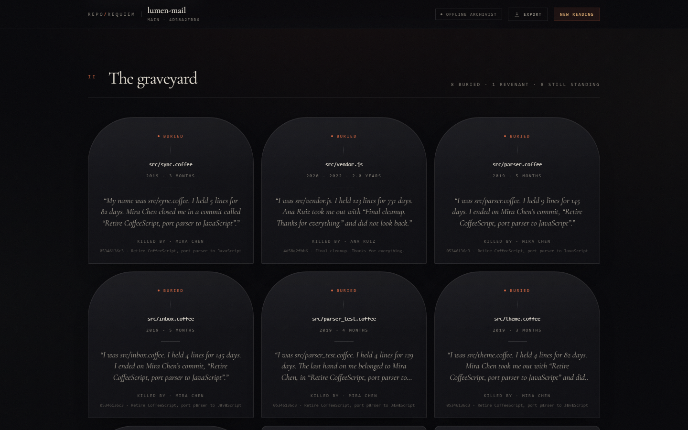
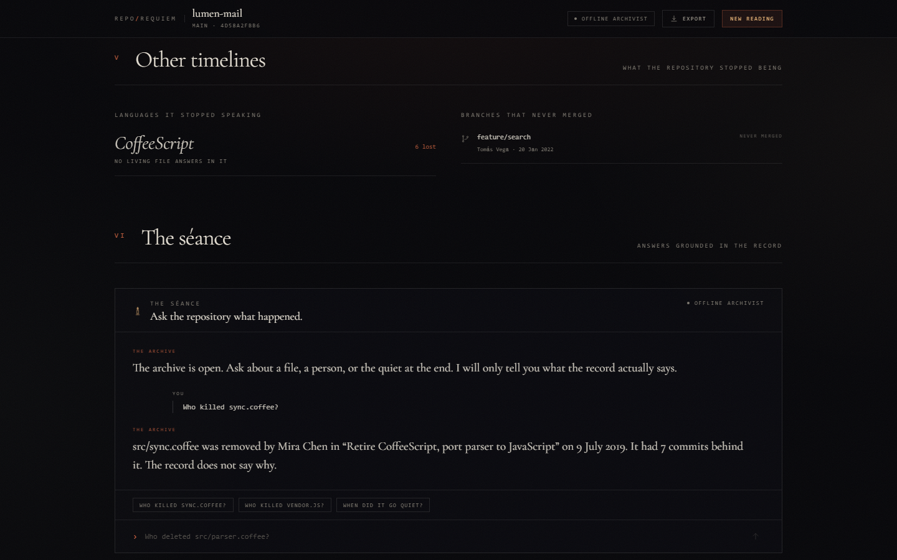

<!--
Draft notes (remove before publishing):
- Upload the images in docs/screenshots/ to DEV and replace the relative paths.
- Read it once out loud; the voice should sound like you, not like a launch post.
-->

There is a commit in almost every repository that nobody wants to read.

It is the one that deletes a file. Not a refactor, not a rename — a plain
removal, where the diff is a hundred lines of minus signs and a message like
"cleanup". The file had a life before that. It was created on a Tuesday, changed
eleven times, survived two renames, and then one afternoon it stopped existing.
Git remembers all of it. Nobody asks.

For Hacktoberfest Week 4, the prompt was **"Ghost in the Machine."** The obvious
reading is a haunted chatbot. I wanted the ghost to be something the machine was
already carrying: the history it never shows you. So I built **RepoRequiem**, a
git archaeology tool that exhumes a repository's dead and gives them a voice.


## What it actually reads

RepoRequiem does not ask a model to imagine a repository. It reads the
repository first, deterministically, from git's own objects:

- **The buried.** Every path that appears in history but not in `HEAD`. Each one
  gets a birth date, a death date, a lifespan, its churn, the commit that removed
  it, and the last lines of its content that still exist in the object database.
- **Revenants.** Files that were deleted and later restored. They are rare, and
  they are the best thing in the whole record.
- **The forgotten.** Files still in the tree that nobody has touched in years.
  Being forgotten and being deleted are different deaths.
- **Cursed commits.** The 3 a.m. commit. The Friday the 13th ship. The revert
  spiral. The commit that deletes nine files at once. The one titled `asdf`.
- **Extinct languages.** Languages that survive only among vanished files, with
  no living file left speaking them.
- **Unmerged branches.** Other timelines that never became ancestors of `HEAD`.
- **Souls.** Authors, their commit counts, their first and last appearance, the
  lines they added and took away.

On the bundled demo repository, that produces a record with 18 commits, 3
authors, 8 buried files, one revenant, six cursed commits, one unmerged branch,
and a CoffeeScript era that no longer exists anywhere in the working tree.


## The rule: facts first, model second

The interesting design problem is not "how do I get an LLM to write spooky
prose." It is "how do I get an LLM to write spooky prose that is *true*."

RepoRequiem enforces a one-way street:

1. `analyze()` walks `git log --numstat --no-renames` and `git ls-tree`, builds a
   per-file ledger, and assembles a plain record of facts.
2. `record_facts()` renders that record as text. No adjectives. No speculation.
3. The model receives only those facts, plus a hard rule: never invent a file
   name, person, date, number, commit or event.
4. The reply must be JSON matching a schema. `_extract_json()` tolerates markdown
   fences and stray prose; `_validate_lore()` enforces length limits, drops
   chapters that are too thin, and **discards any lament whose path is not in the
   set of files that actually died**.
5. If anything fails, a deterministic Archivist speaks the same facts without a
   model.

That last step is the part I am proudest of. The fallback is not an error
screen. It is a second voice, written by hand, that uses the same mined facts.
Pull the network cable, stop Ollama, point the app at a machine with no GPU: the
record still arrives, still names real files, still gets the dates right. The UI
simply says **"facts only · no model"** instead of pretending.

This matters for the theme. A ghost that makes things up is a hallucination. A
ghost that can only repeat what the record already contains is a *witness*.

## Why local, open-weight inference

The whole point of reading a private repository is that it is private. Sending
its history to an API would turn an intimate artifact into a request. So the
voice runs locally, through [Ollama](https://ollama.com), on whatever open-weight
model you already have. The app discovers models from `/api/tags`, scores them
(a small instruct model beats a code model for this task), and respects an
explicit `OLLAMA_MODEL` override. Any OpenAI-compatible endpoint serving an
open-weight model works as an escape hatch, but it is not required.

The inference layer is deliberately boring: one POST to `/api/chat`, JSON mode,
a timeout, and a fallback. No framework, no orchestration graph, no vector
database. The hard part of this project is the archaeology, not the plumbing.

## The graveyard

Each buried file becomes a headstone. Open one and you get a certificate of
removal: born, died, lifespan in days, churn, the hand that removed it, the
commit message, and the last lines of the file as they were.



The details are what make it feel like a place rather than a dashboard. A file
that lived for 82 days and was killed by a commit called "Retire CoffeeScript,
port parser to JavaScript" reads differently from a vendored file that survived
two years and was removed in "Final cleanup. Thanks for everything."

The demo repository is generated by a script, and every date in it is real to
git. It has a CoffeeScript era that goes extinct, a 3 a.m. commit, a revert, a
Friday the 13th release, an unmerged `feature/search` branch, and a file that
comes back from the dead. The scanner does not know any of that in advance. It
just reads.

## The séance

You can ask the archive questions. The retrieval step is intentionally simple:
match the question against file paths, authors, and the facts block, then give
the model only the matching evidence and the record.



If the model is unavailable, the séance answers from the same retrieved facts
directly. If the record does not say, it says that. "The record does not say
why" is a valid answer, and one of the most useful ones a tool like this can
give.

## What was hard

**Detecting deletion without lying.** Git does not store a "this file died" event.
A file can disappear because it was deleted, renamed, moved into a submodule, or
because the history was truncated. I used `--no-renames` and treat a commit as a
deletion when it removes lines and adds none, then cross-check against
`git ls-tree`. It is a heuristic, and the README says so. The interface never
claims more certainty than the data supports.

**Keeping generation honest at the boundary.** Models love to add a detail. The
validator is the actual product: strict schema, length caps, and a path allowlist
for laments. If the model returns a beautiful paragraph about a file that never
existed, that paragraph is thrown away.

**Making failure look intentional.** The first version showed an error toast when
Ollama was missing. It felt like a broken app. The second version treats the
Archivist as a real voice, with its own copy and its own pacing, so a machine
without a model is still a complete experience.

**The aesthetic.** I did not want another dark SaaS dashboard with a purple
gradient. The interface is a reading room: near-black paper, a bone serif, candle
and ember accents, roman numerals, and a lot of silence. The facts are set in
mono. The voice is set in italic. You can tell which is which without a legend.

## Run it

The source is at **<https://github.com/RameezHiro/reporequiem>**. There is no
hosted demo: the point is that the history never leaves the machine. Clone it
and run it locally.

```bash
git clone https://github.com/RameezHiro/reporequiem.git
cd reporequiem/frontend && npm install && npm run build
cd ../backend && pip install -r requirements.txt
uvicorn main:app --port 8000
```

Open `http://127.0.0.1:8000`, or add `?demo=1` to walk straight into the bundled
haunted repository. If you have Ollama running with a suitable text model, it
will pick one; if you do not, the Archivist will read the record anyway.

The stack is deliberately small: FastAPI, React, Vite, Tailwind. No database, no
accounts, no telemetry. Scans live in memory and expire. Public clones are
deleted with the scan.

## What I would do next

- Read renames properly instead of treating them as death and birth.
- Add a "diff between two ghosts" view: what the file was, and what replaced it.
- Let the archive write a real obituary for an *author* who left the project.
- Package the scanner as a CLI so it can run in CI and post a repository's ghost
  record on every release.

But the core idea is finished, and it is the one I wanted: the machine already
knows what it lost. RepoRequiem just makes it say so.

---

*Built for the [DEV Hacktoberfest 2026 Week 4 challenge](https://dev.to/challenges/hacktoberfest-week4-2026-10-26) — "Ghost in the Machine" — tagged `#hf26challenge`.*

*AI disclosure: I used an AI coding assistant to pair on the implementation and
to help draft this post. Every claim about the app was checked against the
running build; the facts in the demo record come from git, not from the model.*
